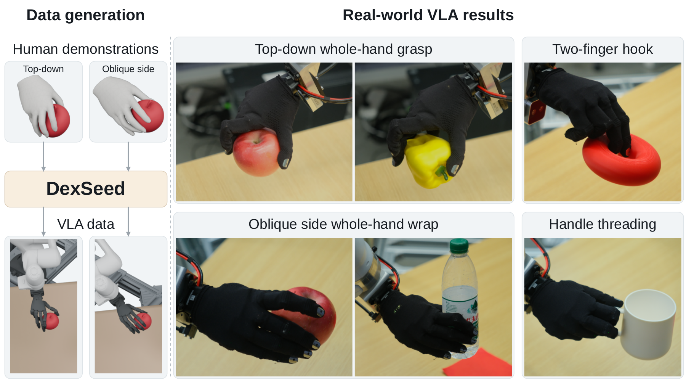

<h1 align="center">DexSeed</h1>
<h3 align="center">Expanding Human Hand–Object Interactions into Robot Demonstrations for Dexterous Policy Learning</h3>

<p align="center">
  <a href="https://phj128.github.io/">Huaijin Pi</a><sup>1,2</sup>,
  <a href="https://zehongs.github.io/">Zehong Shen</a><sup>2,*</sup>,
  Yong Wang<sup>3</sup>,
  <a href="https://xukechun.github.io/">Kechun Xu</a><sup>2</sup>,
  Changpeng Wang<sup>3</sup>,<br>
  <a href="https://kune1008.github.io/">Dingkun Wei</a><sup>2,3</sup>,
  Xueyang Wang<sup>2,3</sup>,
  <a href="https://wenjiawang0312.github.io/">Wenjia Wang</a><sup>1</sup>,
  Xing Zhu<sup>2</sup>,
  <a href="https://shenyujun.github.io/">Yujun Shen</a><sup>2,†</sup>,
  <a href="https://i.cs.hku.hk/~taku/">Taku Komura</a><sup>1,†</sup>
</p>

<p align="center">
  <sup>1</sup> The University of Hong Kong &nbsp;&nbsp;
  <sup>2</sup> Robbyant &nbsp;&nbsp;
  <sup>3</sup> Zhejiang University<br>
  <sup>*</sup> Project Lead &nbsp;&nbsp; <sup>†</sup> Corresponding Authors
</p>

<p align="center">
  <a href="https://robbyant-research.github.io/DexSeed/"><b>Project Page &amp; Demos</b></a>
  &nbsp;·&nbsp; arXiv: Coming soon
</p>

<p align="center">
  
</p>

**From human interactions to real-world dexterous manipulation.** DexSeed expands human hand–object interactions into physically executable robot demonstrations across object geometries and manipulation locations. A VLA fine-tuned solely on the generated demonstrations performs language-specified grasps on a real robot, without collecting real-robot action demonstrations.

## Code release

**Coming soon.** We are preparing the code release. The implementation and instructions for using it will be added to this `main` branch.

Explore the method, videos, and experimental results on the [project page](https://robbyant-research.github.io/DexSeed/). Its source and media are maintained on the [`gh-pages` branch](https://github.com/robbyant-research/DexSeed/tree/gh-pages).

## Citation

If you find DexSeed useful for your research, please cite:

```bibtex
@misc{pi2026dexseed,
  title = {DexSeed: Expanding Human Hand--Object Interactions into Robot Demonstrations for Dexterous Policy Learning},
  author = {Huaijin Pi and Zehong Shen and Yong Wang and Kechun Xu and Changpeng Wang and Dingkun Wei and Xueyang Wang and Wenjia Wang and Xing Zhu and Yujun Shen and Taku Komura},
  year = {2026},
  url = {https://robbyant-research.github.io/DexSeed/}
}
```

<sub>Huaijin Pi, Yong Wang, Changpeng Wang, Dingkun Wei, and Xueyang Wang conducted this work during their internships at Ant Group.</sub>
